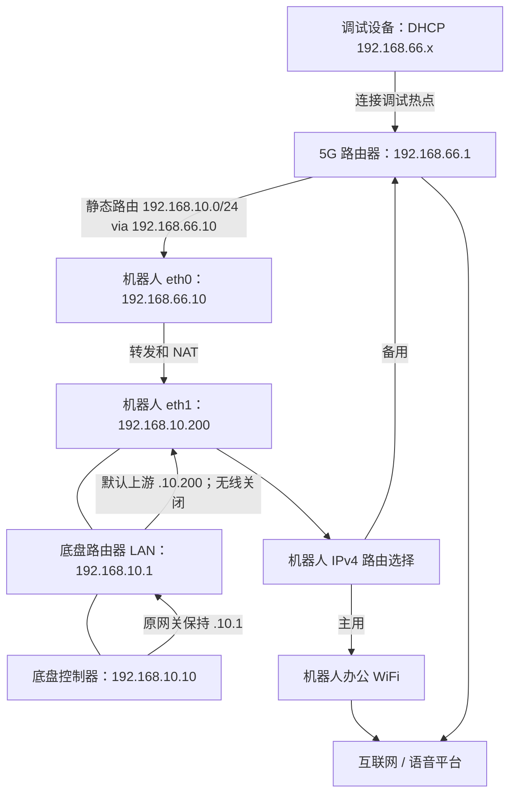

# 机器人网络工具箱

把调试热点、底盘局域网和机器人双互联网出口连起来，并记录从零排障到验收的经验。适合先按图理解，再逐项验证的人。示例使用两段私有地址；真实现场密码、SSH 指纹、SSID、设备标识和原始报告均不在仓库中。

本项目来自一次真实机器人网络改造：机器人有两个有线网口和一个物理无线网卡，底盘网段不能更改，调试设备需要“连热点就能打开底盘网页”。最终实现：

- 热点客户端通过路由器静态路由、机器人 IPv4 转发和 NAT，访问底盘网页及其 WebSocket 服务。
- 底盘设备保持原 IP、网关和 DNS；底盘路由器关闭无线，只把默认上游指向机器人。
- 机器人和底盘共享机器人的 IPv4 出口，办公 WiFi 优先，蜂窝网络备用。
- 绑定各自网卡的 DNS + TLS/HTTP 健康检查，连续失败后切换，恢复后等待再回切。
- 默认预演、变更前备份、验收失败回滚、失联 12 分钟未确认自动回滚。

**这套方案没有实现带宽聚合，也不保证现有语音长连接无缝迁移。** 健康检查判断可达性；主用网络由实测结果选择，不因几毫秒波动频繁切换。IPv6 沿用原配置。

## 先看网络



两段网仍是两个子网，通过三层路由互通。广播发现不会自动穿过路由器；请直接填底盘 IP。底盘路由器是同一个 LAN 上的中转节点，现有 LAN 网线继续使用，无需把网线改插 WAN 口。

## 阅读顺序

1. [从零到验收的学习记录](docs/learning.md)：为什么 ping 通了网页仍失败，如何逐层缩小问题。
2. [地址、报文和防止环路](docs/architecture.md)：三种流量逐跳怎么走。
3. [部署、验证和回滚](docs/operations.md)：首次配置、命令和成功标准。
4. [现场测量与局限](docs/measurements.md)：5G 与 WiFi 的公平比较，以及尚未证明的内容。

## 快速开始

支持范围：在 Ubuntu 22.04 / NetworkManager 1.36 / nftables 的 ARM64 机器人、定制 OpenWrt 18.06 底盘路由器上验证。其他固件、现有 VPN/容器转发、防火墙规则应先审查。工具安装一个默认拒绝其他 IPv4 转发的独立表；不会清空整套 nftables，但其他链仍可能影响最终放行结果。

机器人需要 `python3`、`python3-gi`/`gir1.2-nm-1.0`、`nmcli`、`nft`、`curl`、`ip`、systemd。优化脚本不会替你安装这些系统组件。操作电脑需要 Python 3.9+，安装唯一的额外依赖 Paramiko：

```bash
git clone https://github.com/lizi-learn/robot-network-toolkit.git
cd robot-network-toolkit
python3 -m venv .venv
. .venv/bin/activate
python3 -m pip install -r requirements.txt
cp configs/site.example.json site.local.json
chmod 600 site.local.json
# 编辑 site.local.json：实际管理地址、用户名、已核对的 SSH 指纹、网口等。
./optimize.sh --config site.local.json
# 确认预演报告后执行：
./optimize.sh --config site.local.json --apply
./test.sh --config site.local.json --samples 5
```

密码交互输入，不写入 JSON、命令行参数或仓库。可使用 SSH 密钥，`key_filename` 指定本机路径；SSH 密码留空。自动化可在进程环境中提供 `ROBOT_SSH_PASSWORD`、`ROBOT_SUDO_PASSWORD`、`CHASSIS_SSH_PASSWORD`、`FIVEG_PASSWORD`，选配客户端时加 `CLIENT_SSH_PASSWORD`。不要把带凭据的命令保存到终端历史或共享脚本中。

**首次安装还需在 5G 路由器界面做一次设置：** 将 `192.168.10.0/24` 的下一跳设为 `192.168.66.10`、接口 LAN，并把机器人 eth0 的 MAC 保留给 `.66.10`。本仓库的 NRadio 适配器只检查这两项，不猜测其他厂商的写入接口。不匹配会在任何配置修改前终止。已有其他型号时可 `--skip-fiveg` 跳过后台检查，但须人工验证路由和地址保留；跳过检查不代表已通过。

报告写入 `reports/`，目录 700、文件 600，并被 Git 忽略。报告含现场 IP、MAC、接口等信息，不要直接公开。配置中 `test_client: null` 表示未做外部客户端验收；机器人访问成功不能替代真实热点设备的测试。

## 一键脚本实际做什么

`optimize.sh` 默认仅审计；加 `--apply` 才部署：

1. 核对机器人与底盘路由器 SSH 身份，检查 5G 路由/地址保留，生成差异。
2. 新固定 IP 赋值前做三次 ARP 冲突探测；备份机器人持久配置和当前实际生效的 NetworkManager 配置。
3. 为机器人创建定时回滚保护；部署限定转发、两个方向的 NAT、对称回程和健康监测。
4. 固定 eth0/eth1；eth1 不接受默认路由和 DNS，防止机器人与底盘路由器互指。
5. 必要时仅修改底盘路由器默认上游、DNS 和两个无线开关，独立备份并启动回滚看门狗。
6. 验证底盘 HTTP、ROS 只读诊断、DNS、两条互联网路径，以及可选的真实热点客户端；通过才确认提交。

再次执行会检查相同目标，状态一致时返回 `changed: false`。若正在健康故障切换状态，重新优化会重新确立配置中的主用策略，不宜在故障中反复运行。

`test.sh` 默认不改网络配置（会上传临时探针并产生网络请求）。需要受控出口演练时显式加 `--exercise-failover`；它会暂停健康定时器，切到蜂窝、切到 WiFi，逐项测试，最后恢复原出口并启动定时器。此操作可能中断正在进行的通话，应在维护窗口执行。它证明两条路径可用，**不能代替真实断网故障注入或长时间通话验收**。

```bash
./test.sh --config site.local.json --samples 3 --exercise-failover
python3 -m unittest discover -s tests -v
```

## 源码入口

| 文件 | 职责 |
|---|---|
| `robot_network/client.py` | 操作电脑侧入口、身份校验、事务和验收 |
| `robot_network/agent.py` | 机器人侧配置、备份、幂等判断和回滚 |
| `robot_network/common.py` | 参数校验、规则生成、独立 DNS、切换状态机 |
| `robot_network/health.py` | 绑定网卡探测并调整 IPv4 metric |
| `robot_network/check.py` | 同一服务器地址的双出口 HTTPS 比较 |
| `robot_network/chassis_status.py` | 仅调用底盘诊断读取与网口信息服务 |
| `robot_network/router_web.py` | 5G 路由器只读检查 |
| `assets/` | systemd、nftables 加载器与对称回程维护 |

MIT 许可证。此仓库提供可审查的实现与真实经验，实际部署前请核对地址、固件能力和现有转发业务。
